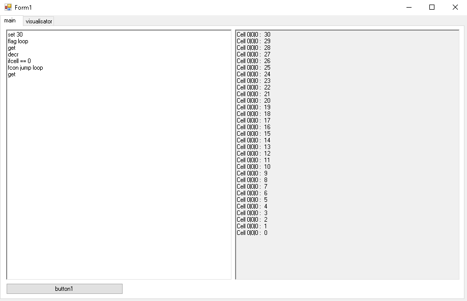
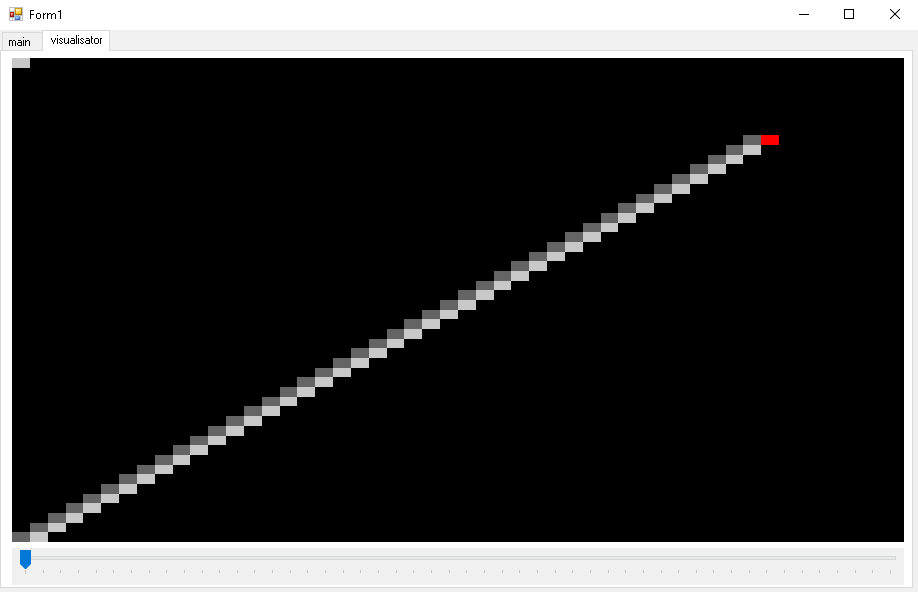
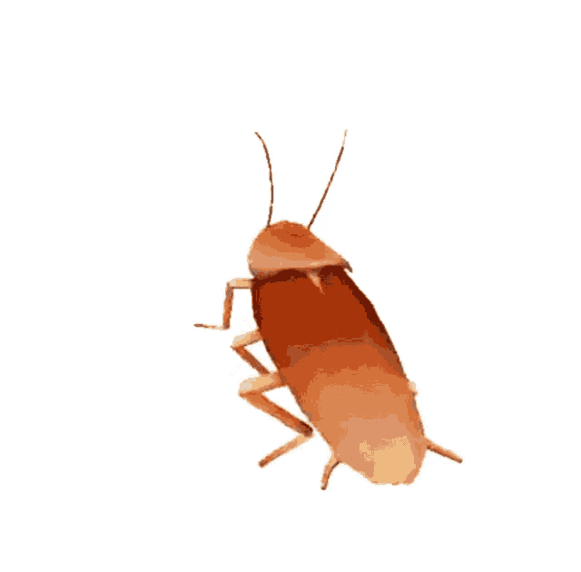

# CwPs — Таракан с карманами в космосе 🪳🚀

> **Дисклеймер:** Этот README изначально написал **DeepSeek**, потому что автору было лень писать огромную стену текста. Весь код, пот и 5 часов страданий — это его. 😄
>
> **Обновление:** справочник по языку ниже синхронизирован с `Form1.cs`; добавлены пропущенные команды и описано реальное поведение интерпретатора.

Маленький 3D-воксельный интерпретатор / визуализатор на C# WinForms, в котором отважный таракан с карманами бродит по сетке из байтов размером 50×50×50 и выполняет самописный стековый скриптовый язык.

---

### Редактор кода

*Скрипт пишется прямо внутри приложения.*

### 3D-визуализатор (вид по слоям)

*Один Z-слой за раз, а красный курсор ни с чем не спутаешь.*

### 🪳 Танцующий таракан

*Зачем? Потому что почему бы и нет.*

---

## ✨ Что это такое?

**CwPs** (Cockroach with Pockets in Space) — это интерпретатор небольшого самописного языка, который манипулирует трёхмерным массивом байтов (`byte[50, 50, 50]`). Интерпретатором "управляет" виртуальный таракан — 3D-курсор, который двигается, поворачивается и взаимодействует с клетками, на которых стоит.

Всё хранится в **карманах** таракана — это LIFO-стек из байтов. В карманы можно забирать значения, выкидывать их обратно в мир, делать над ними арифметические/побитовые операции, дублировать/менять местами значения и управлять тараканом через if/jump.

Визуализатор показывает один горизонтальный срез (Z-слой) за раз, переключаться между слоями можно через трекбар. Сам таракан отрисовывается красным пикселем, чтобы не потерять его в темноте.

Каждый запуск **CodeTransform** сбрасывает мир, позицию курсора, карманы и флаги перед выполнением скрипта.

---

## 🧠 Возможности

- 🐛 **3D-курсор** ("таракан") с движением по yaw/pitch
- 🎒 **Стек карманов** (нативный `Stack<byte>` в C#) с `bring`, `drop`, `padd`, `psub`, `ppop`, `pdup`, `pswap`, `pand`, `por`
- 🏗️ **Мир 50×50×50** (байт на клетку, монохромный рендер)
- 🎨 **Послойный визуализатор** с переключением Z-среза и отображением координат
- 🧾 **Самописный язык** с метками, переходами и условиями
- 🧪 **Отладочные команды** (`cpd`, `crd`, `get`, `chpk`), сваливающие инфу в консоль
- ⏱️ **Защита от бесконечных циклов** — выполнение прерывается после 1 000 000 итераций по строкам
- 💾 **Сохранение/загрузка скриптов** (`.cwp`, `.txt` или любой файл) через встроенные кнопки
- 💥 **В основном Fail-Fast** — кривые известные команды и пустые карманы кидают исключения; неизвестные команды игнорируются (см. ограничения)

---

## 🕹️ Справочник по языку

Каждая строка — одна команда. Множественные пробелы игнорируются. Имена команд регистронезависимы. Пустые строки пропускаются. Строки, начинающиеся с `//`, считаются комментариями.

Имена флагов регистрозависимы. Для `set p` нужна именно строчная `p`.

### Повороты
| Команда | Описание |
|---------|----------|
| `<`     | Поворот по горизонтали (yaw) влево; заворачивается `0 → 3` |
| `>`     | Поворот по горизонтали (yaw) вправо; заворачивается `3 → 0` |
| `^`     | Поднять вертикальный поворот; ограничен `+1`. Из `-1` возвращает в `0` |
| `v`     | Опустить вертикальный поворот; ограничен `-1`. Из `+1` возвращает в `0` |

Вертикальный поворот (`^` / `v`) имеет приоритет над горизонтальным. Когда вертикальный поворот равен `+1` или `-1`, `move` сдвигает таракана по оси Z, а не по X/Y.

### Движение
| Команда       | Описание |
|---------------|----------|
| `move`        | Шаг на 1 вперёд |
| `move <n>`    | Шаг на `n` вперёд; `n` парсится как `int` |

Горизонтальное направление, когда вертикальный поворот равен `0`:

| Горизонтальный поворот | Направление |
|------------------------|-------------|
| `0`                    | `X+`        |
| `1`                    | `Y-`        |
| `2`                    | `X-`        |
| `3`                    | `Y+`        |

Вертикальное направление:

| Вертикальный поворот | Направление |
|----------------------|-------------|
| `+1`                 | `Z+`        |
| `-1`                 | `Z-`        |

Положительное движение заворачивается по границам мира через modulo. Отрицательные значения `move <n>` не защищены и могут дать координаты вне мира; используй неотрицательные шаги.

### Карманы (стек)
| Команда    | Описание |
|------------|----------|
| `bring`    | Забрать значение клетки в карман и обнулить клетку |
| `drop`     | Записать верхнее значение кармана в клетку, затем удалить его из кармана |
| `padd`     | Прибавить верхнее значение кармана к клетке, затем удалить его |
| `psub`     | Вычесть верхнее значение кармана из клетки, затем удалить его |
| `ppop`     | Удалить (выбросить) верхнее значение кармана |
| `pdup`     | Дублировать верхнее значение кармана |
| `pswap`    | Поменять местами два верхних значения кармана, если их хотя бы два; иначе молча ничего не делает |

### Операции с клеткой
| Команда          | Описание |
|------------------|----------|
| `set p`          | Установить клетку в верхнее значение кармана (peek, без удаления). Нужна строчная `p` |
| `set <byte>`     | Установить клетку в число (0–255) |
| `incr`           | Инкремент клетки |
| `decr`           | Декремент клетки |
| `rand`           | Установить клетку в случайный байт (0–255) |
| `pand`           | Побитовое AND клетки с верхним значением кармана, затем удалить значение |
| `por`            | Побитовое OR клетки с верхним значением кармана, затем удалить значение |

### Управляющие конструкции
| Команда              | Описание |
|----------------------|----------|
| `flag <name>`        | Пометить текущую строку как точку перехода |
| `jump <name>`        | Перейти к ранее объявленной метке; выполнение продолжится со строки после метки |
| `ifcell <op> <byte>` | Сравнить клетку со значением (`==`, `!=`, `>`, `>=`, `<`, `<=`) |
| `sct`                | Принудительно установить условие = true |
| `scf`                | Принудительно установить условие = false |
| `tcon <команда>`     | Выполнить остаток строки как команду, если условие истинно |
| `fcon <команда>`     | Выполнить остаток строки как команду, если условие ложно |

Пример: `tcon move 3` выполнит `move 3` только если текущее условие истинно.

### Отладка
| Команда  | Описание |
|----------|----------|
| `cpd`    | Вывести позицию таракана (X, Y, Z) |
| `crd`    | Вывести последнее направление движения (`Null` до первого `move`) |
| `get`    | Вывести значение клетки под тараканом |
| `chpk`   | Вывести верхнее значение кармана |

---

## 🚀 Как начать

### Требования
- Windows
- .NET Framework (WinForms)
- Visual Studio (или `msbuild`)

### Сборка
1. Склонируй репозиторий.
2. Открой `.sln` в Visual Studio.
3. Собери и запусти (`F5`).

### Запуск
1. Вставь скрипт в редактор кода.
2. Нажми **CodeTransform**, чтобы выполнить. Это сбросит мир, курсор, карманы и флаги.
3. Крути трекбар, чтобы гулять по Z-слоям.
4. Смотри в консоль вывода на результаты `get` / `cpd` / `crd` / `chpk`.
5. Используй **Save** / **Load** для сохранения или открытия скриптов (`.cwp`, `.txt` или любой файл).

---

## ⚠️ Известные ограничения (то есть почему он только «в основном» Fail-Fast)

- Известные команды с отсутствующими/неверными аргументами могут кидать исключения; обращение к пустому карману через `Peek`/`Pop` тоже кидает исключение. Исключения ловятся и выводятся в консоль.
- **Неизвестные команды молча игнорируются** — в `switch` нет `default`. Так что утверждение «любая кривая команда → исключение» неверно.
- `pswap` при менее чем двух значениях в кармане молча ничего не делает.
- Для `set p` нужна именно строчная `p`.
- Непустая строка из одного символа, не являющаяся комментарием, может кинуть исключение на проверке комментария (`Line.Substring(0, 2)`), потому что строка короче двух символов.
- Отрицательные значения `move <n>` не защищены и могут дать координаты вне мира.
- Значения клеток молча заворачиваются (байтовая арифметика).
- Константы `MaxX / MaxY / MaxZ` намеренно занижены — мир 1000³ съест **~1 ГБ RAM**, а у автора всего 3 ГБ. Не поднимай их без реальной нужды.
- Рендерится только текущий Z-слой. Это визуализатор, а не raytracer. 😅
- Консоль вывода заполняется после завершения выполнения, а не в реальном времени.

---

## 🗺️ Планы (может быть)

- [ ] Режим без Fail-Fast (если таракан когда-нибудь научится осторожности)
- [ ] Полноценный 3D-рендер вместо одного Z-среза
- [ ] Сохранение/загрузка состояния мира (сохранение/загрузка скриптов уже есть)
- [ ] Больше команд (условный move, больше арифметики с карманами и т.п.)
- [ ] Безопасный парсинг комментариев и коротких строк
- [ ] Танцующему таракану — отдельное меню

---

## License

MIT © 2026 furduk

---

## 🙏 Благодарности

- **Автор:** человек, написавший первую версию за 5 часов и теперь заслуживший отдых
- **Автор README:** DeepSeek (который был очень озадачен танцующим тараканом, но не стал спрашивать)
- **Обновление README:** синхронизировано с `Form1.cs` и реальным поведением интерпретатора

Особенная благодарность DeepSeek от автора за написание этого README

🪳 Удачного скриптинга! 🪳