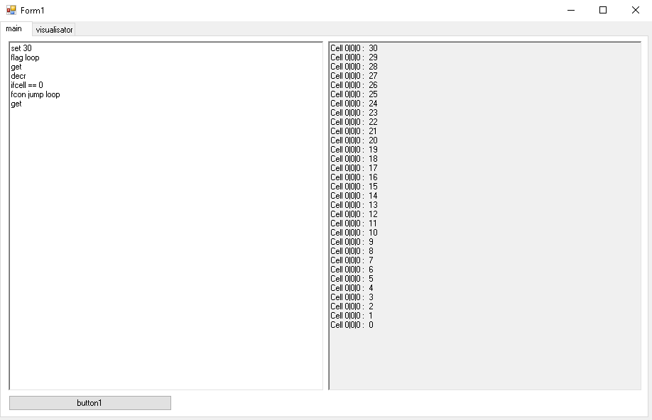
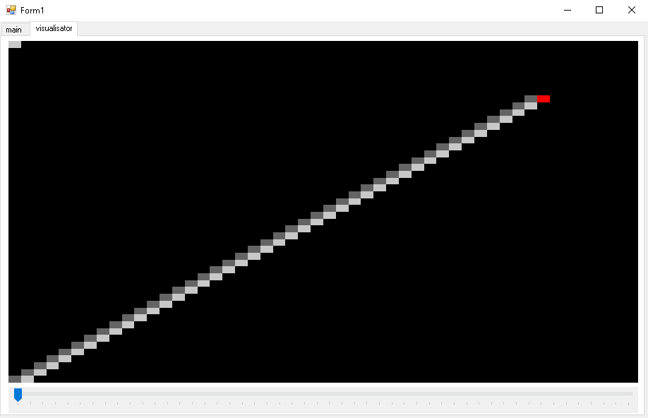
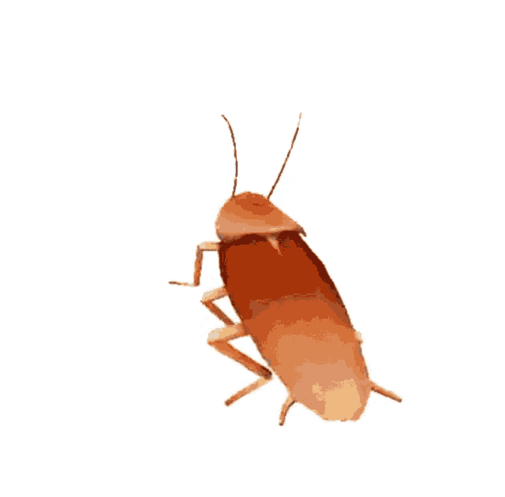

# CwPs — Cockroach with Pockets in Space 🪳🚀

> **Disclaimer:** This README was originally written by **DeepSeek**, because the author was too lazy to write a giant wall of text himself. All the code, sweat, and 5 hours of suffering — that's his. 😄
>
> **Update:** the language reference below is synchronized with `Form1.cs`; missing commands and real interpreter behavior are documented.

A tiny 3D voxel interpreter / visualizer written in C# WinForms, where a heroic cockroach with pockets wanders through a 50×50×50 grid of bytes, executing a custom stack-based scripting language.

---

### The Code Editor

*Write your script right inside the app.*

### The 3D Visualizer (layer view)

*One Z-layer at a time, with the red cursor standing out.*

### 🪳 Dancing Cockroach

*Why? Because why not.*

---

## ✨ What is this?

**CwPs** (Cockroach with Pockets in Space) is a small interpreter for a custom language that manipulates a 3-dimensional array of bytes (`byte[50, 50, 50]`). The interpreter is "driven" by a virtual cockroach — a 3D cursor that moves, rotates, and interacts with the cells it stands on.

Everything is stored in the cockroach's **pockets** — a LIFO stack of bytes. You can bring values into the pockets, drop them back into the world, do arithmetic/bitwise operations with them, duplicate/swap pocket values, and control the cockroach with an if/jump system.

The visualizer shows a single horizontal slice (Z-layer) at a time, and you can scroll through layers with a trackbar. The cockroach itself is rendered as a red pixel so you don't lose it.

Each **CodeTransform** run resets the world, cursor position, pockets, and flags before executing the script.

---

## 🧠 Features

- 🐛 **3D cursor** ("cockroach") with yaw/pitch-based movement
- 🎒 **Stack of pockets** (native C# `Stack<byte>`) with `bring`, `drop`, `padd`, `psub`, `ppop`, `pdup`, `pswap`, `pand`, `por`
- 🏗️ **50×50×50 voxel world** (byte per cell, monochrome rendering)
- 🎨 **Layer visualizer** with adjustable Z slice and coordinate display
- 🧾 **Custom scripting language** with labels, jumps, conditions
- 🧪 **Debug commands** (`cpd`, `crd`, `get`, `chpk`) that dump info to the console
- ⏱️ **Infinite loop protection** — execution is safely aborted after 1,000,000 line iterations
- 💾 **Script save/load** (`.cwp`, `.txt`, or any file) via the built-in buttons
- 💥 **Mostly fail-fast** — bad known commands and empty-pocket access throw; unknown commands are ignored (see limitations)

---

## 🕹️ Language Reference

Each line is one command. Multiple spaces are ignored. Command names are case-insensitive. Empty lines are skipped. Lines starting with `//` are treated as comments.

Flag names are case-sensitive. `set p` requires a lowercase `p`.

### Rotation
| Command | Description |
|---------|-------------|
| `<`     | Rotate horizontal (yaw) left; wraps `0 → 3` |
| `>`     | Rotate horizontal (yaw) right; wraps `3 → 0` |
| `^`     | Adjust vertical rotation upward; clamped to `+1`. From `-1` it returns to `0` |
| `v`     | Adjust vertical rotation downward; clamped to `-1`. From `+1` it returns to `0` |

Vertical rotation (`^` / `v`) takes priority over horizontal rotation. When vertical rotation is `+1` or `-1`, `move` shifts along the Z axis instead of X/Y.

### Movement
| Command       | Description |
|---------------|-------------|
| `move`        | Move 1 step forward |
| `move <n>`    | Move `n` steps forward; `n` is parsed as `int` |

Horizontal direction when vertical rotation is `0`:

| Horizontal rotation | Direction |
|---------------------|-----------|
| `0`                 | `X+`      |
| `1`                 | `Y-`      |
| `2`                 | `X-`      |
| `3`                 | `Y+`      |

Vertical direction:

| Vertical rotation | Direction |
|-------------------|-----------|
| `+1`              | `Z+`      |
| `-1`              | `Z-`      |

Positive movement wraps around world boundaries via modulo. Negative `move <n>` values are not guarded and can produce out-of-range coordinates; use non-negative steps.

### Pockets (stack)
| Command    | Description |
|------------|-------------|
| `bring`    | Take cell's value into pockets and zero the cell |
| `drop`     | Write top pocket value into cell, then pop it |
| `padd`     | Add top pocket value into cell, then pop it |
| `psub`     | Subtract top pocket value from cell, then pop it |
| `ppop`     | Pop (discard) the top pocket value |
| `pdup`     | Duplicate the top pocket value |
| `pswap`    | Swap the top two pocket values if at least two exist; otherwise silently does nothing |

### Cell operations
| Command          | Description |
|------------------|-------------|
| `set p`          | Set cell to top pocket value (peek, does not pop). Lowercase `p` required |
| `set <byte>`     | Set cell to a numeric value (0–255) |
| `incr`           | Increment cell |
| `decr`           | Decrement cell |
| `rand`           | Set cell to a random byte (0–255) |
| `pand`           | Bitwise AND cell with top pocket value, then pop |
| `por`            | Bitwise OR cell with top pocket value, then pop |

### Control flow
| Command              | Description |
|----------------------|-------------|
| `flag <name>`        | Mark the current line as a jump target |
| `jump <name>`        | Jump to a previously declared flag; execution continues after the flag line |
| `ifcell <op> <byte>` | Compare cell with value (`==`, `!=`, `>`, `>=`, `<`, `<=`) |
| `sct`                | Force condition = true |
| `scf`                | Force condition = false |
| `tcon <command>`     | Execute the rest of the line as a command if condition is true |
| `fcon <command>`     | Execute the rest of the line as a command if condition is false |

Example: `tcon move 3` executes `move 3` only if the current condition is true.

### Debug
| Command  | Description |
|----------|-------------|
| `cpd`    | Print cockroach position (X, Y, Z) |
| `crd`    | Print the last movement direction (`Null` before the first `move`) |
| `get`    | Print the value of the cell under the cockroach |
| `chpk`   | Print the top pocket value |

---

## 🚀 Getting Started

### Requirements
- Windows
- .NET Framework (WinForms)
- Visual Studio (or `msbuild`)

### Build
1. Clone the repo.
2. Open the `.sln` in Visual Studio.
3. Build & run (`F5`).

### Run
1. Paste your script into the code editor.
2. Click **CodeTransform** to run it. This resets the world, cursor, pockets, and flags.
3. Scroll the trackbar to browse Z-layers.
4. Watch the output console for `get` / `cpd` / `crd` / `chpk` results.
5. Use **Save** / **Load** to store or open scripts (`.cwp`, `.txt`, or any file).

---

## ⚠️ Known limitations (a.k.a. why it is only “mostly” Fail-Fast)

- Known commands with missing/invalid arguments can throw; empty-pocket `Peek`/`Pop` also throws. Exceptions are caught and printed to the output console.
- **Unknown commands are silently ignored** — the `switch` has no `default` case. So “any malformed command → exception” is not true.
- `pswap` with fewer than two pocket values silently does nothing.
- `set p` requires lowercase `p`.
- A one-character non-empty line that is not a comment can throw during the comment check (`Line.Substring(0, 2)`), because the line is shorter than two characters.
- Negative `move <n>` values are not guarded and can produce out-of-range coordinates.
- Cell values wrap around silently (byte arithmetic).
- The `MaxX / MaxY / MaxZ` constants are capped low on purpose — a 1000³ world would eat **~1 GB of RAM**, and the author's PC only has 3 GB. Don't raise them unless you have the RAM to burn.
- Only the current Z-layer is rendered at a time. It's a visualizer, not a raytracer. 😅
- The output console is filled after execution finishes, not streamed live.

---

## 🗺️ Roadmap (maybe)

- [ ] Non-fail-fast mode (if the cockroach ever learns to be careful)
- [ ] Full 3D rendering instead of a single Z-slice
- [ ] Save/load world state (script save/load already exists)
- [ ] More commands (conditional move, more arithmetic on pockets, etc.)
- [ ] Safer parsing for comments and short lines
- [ ] The dancing cockroach gets its own menu

---

## License

MIT © 2026 furduk

---

## 🙏 Credits

- **Author:** the human who wrote this in 5 hours and now needs a break
- **README author:** DeepSeek (who was very confused why the cockroach dances, but didn't ask)
- **README update:** synchronized with `Form1.cs` and actual interpreter behavior

Special thanks to DeepSeek from author for writing this README

🪳 Happy scripting! 🪳